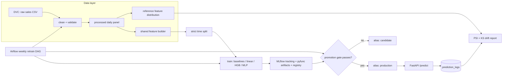

# Demand Forecasting MLOps Pipeline

Predict next-day unit sales per store and item, and demonstrate the complete machine-learning lifecycle: versioned data, strict time-based validation, tracked experiments, an honest baseline/model comparison, a registry-backed API, gated promotion, scheduled retraining, prediction logging and drift monitoring.

## Contents

- [What this project demonstrates](#what-this-project-demonstrates)
- [Architecture](#architecture)
- [Tech stack](#tech-stack)
- [Repository layout](#repository-layout)
- [Quick start](#quick-start)
- [Configuration](#configuration)
- [Data and pipeline](#data-and-pipeline)
- [Models and tracking](#models-and-tracking)
- [Registry and promotion](#registry-and-promotion)
- [Serving API](#serving-api)
- [Airflow retraining DAG](#airflow-retraining-dag)
- [Monitoring and drift](#monitoring-and-drift)
- [Testing and CI](#testing-and-ci)
- [Results](#results)
- [Design decisions and scaling](#design-decisions-and-scaling)
- [Roadmap and known limitations](#roadmap-and-known-limitations)
- [Dataset source and license](#dataset-source-and-license)

---

## What this project demonstrates

1. **Reproducible data pipeline** — raw data is DVC-tracked; `dvc repro` rebuilds processed data, features, models and reports.
2. **No leakage** — features for day `t` use only observations through `t-1`; splits are strictly ordered in time.
3. **Fair comparison** — two baselines, linear regression, histogram gradient boosting and a PyTorch MLP are scored on the identical validation window.
4. **Experiment tracking** — every model gets one MLflow run with parameters, metrics, tags and a versioned `mlflow.pyfunc` artifact.
5. **Safe promotion** — a pure decision gate refuses models that do not clearly beat the best baseline and the current production model.
6. **Zero-restart serving** — FastAPI polls the MLflow registry alias and swaps models without a restart.
7. **Observability** — every prediction is logged; PSI and Kolmogorov–Smirnov tests detect input drift.
8. **Honest reporting** — all metrics in this README come from real generated artifacts; unavailable credentials or tooling are recorded as fallbacks in `docs/DECISIONS.md`.

---

## Architecture



The feature function in `src/features/build.py` is the **only** feature implementation used by both batch training and single-request serving. This prevents train/serve skew. Calendar features for day `t` are known at the end of `t-1`; all lag and rolling features are computed from shifted sales, so no same-day or future `sales` value can enter a feature row.

---

## Tech stack

| Area | Choice | Why |
|---|---|---|
| Language / packaging | Python 3.11, `pyproject.toml`, pinned requirements | Reproducible installs; project is tested locally on 3.15 but targets 3.11 |
| Data / features | pandas, numpy, pyarrow, `holidays` | Fast panel operations, parquet storage, real calendar holidays |
| Data versioning | DVC with the local remote configured in `.dvc/config` | Large data stays out of Git while remaining reproducible |
| Validation | explicit pandas checks with `DataValidationError`; pandera pinned for later migration | Dependency-light, readable aggregated errors |
| Models | last-week, moving-average, Ridge, HistGradientBoostingRegressor, PyTorch MLP with ID embeddings | Strong classical baselines plus a neural comparison |
| Tracking / registry | MLflow 3, SQLite locally, Postgres in Compose | SQLite supports registry aliases locally; Postgres for the full stack |
| Serving | FastAPI, Pydantic v2, uvicorn | Strict request validation and async-friendly testing |
| Orchestration | Airflow 2.10, LocalExecutor, weekly DAG | Thin orchestration over the same `src` functions |
| Logging / drift | SQLAlchemy + Postgres/SQLite, PSI and KS via scipy | Best-effort logging and interpretable drift statistics |
| Tests / CI | pytest, pytest-cov, httpx/TestClient, ruff, GitHub Actions | 80% coverage gate, lint/format checks, image build check |
| Containers | Docker and Docker Compose | One-command stack for MLflow, Airflow, Postgres and API |

---

## Repository layout

```text
.
├── .github/
│   └── workflows/ci.yml        # lint, pipeline rebuild, tests and API image build
├── dags/
│   └── retrain_dag.py          # weekly Airflow DAG; business logic stays in src/
├── data/                       # DVC pointers only; parquet/CSV content is not in Git
│   ├── raw/train.csv.dvc
│   ├── processed/              # generated sales.parquet and features.parquet
│   └── reference/              # generated training-feature reference distribution
├── docs/
│   ├── DECISIONS.md            # every fallback and deviation from plan.md
│   ├── HANDOFF.md              # human-only remaining items
│   ├── PROGRESS.md             # step-by-step completion log
│   ├── RESUME_NUMBERS.md       # measured numbers for resume bullets
│   └── images/                 # EDA plots and screenshot placeholders
├── notebooks/
│   └── 01_eda.ipynb            # exploration only; no business logic
├── reports/
│   ├── api_examples.md         # captured real HTTP responses
│   ├── baseline_metrics.json   # baseline scores
│   ├── drift_normal.md         # no-drift evidence
│   ├── drift_report.md/html    # shifted-traffic PSI + KS report
│   ├── evaluation.json         # all model scores and split metadata
│   ├── latency.json            # measured load-test results
│   ├── model_comparison.csv/md # generated comparison table
│   ├── promotion_decision.json # gate verdict and metrics
│   ├── train_summary.json      # run IDs, metrics and provenance
│   └── predictions/            # DVC-cached per-model prediction CSVs, Git-ignored
├── scripts/
│   ├── download_data.sh        # Kaggle download (requires credentials)
│   ├── init_db.sql             # creates mlflow, airflow and app databases
│   ├── make_synthetic_data.py  # deterministic fallback generator
│   ├── seed_demo_traffic.py    # normal + shifted API traffic for drift demo
│   └── load_test.py            # concurrent latency measurement
├── src/
│   ├── config.py               # params.yaml + deployment env vars
│   ├── data/                   # load, clean, validate, prepare
│   ├── features/               # shared batch/serve features and time split
│   ├── models/                 # baselines, metrics, sklearn models, NN, training, promotion
│   ├── monitoring/             # PSI/KS drift and report CLI
│   └── serving/                # schemas, model loader, app, prediction logging
├── tests/                      # unit, leakage, API, promotion, drift and DAG tests
├── Dockerfile / Dockerfile.airflow
├── docker-compose.yml          # postgres + mlflow + api + airflow services
├── dvc.yaml / dvc.lock         # pipeline definition and committed state
├── params.yaml                 # single source of truth for all hyperparameters/settings
├── plan.md                     # original phase and acceptance checklist
├── Makefile                    # convenience targets; underlying commands are plain Python
├── pyproject.toml / requirements*.txt
└── LICENSE
```

Git stores the raw CSV and large generated data only as DVC pointers; the actual bytes live in the DVC cache and remote. Small, reviewable reports are committed directly to Git.

---

## Quick start

### Prerequisites

- Python **3.11** recommended (`pyproject.toml` and Docker images target 3.11).
- `pip`, Git, and DVC. If the `dvc` executable is unavailable, use `python -m dvc` everywhere.
- Docker and Docker Compose for the full stack. Docker was not available in the build environment; Compose acceptance is documented but not executed here.
- Kaggle credentials only if replacing the synthetic fallback with the original competition data.

### 1. Clone and configure

```bash
git clone <your-fork-url> demand-forecasting-mlops
cd demand-forecasting-mlops
cp .env.example .env
python -m pip install -r requirements.txt -r requirements-dev.txt
```

Never commit `.env`. It is ignored by Git.

### 2. Provision data

The repository contains a DVC pointer, not the CSV itself.

```bash
# If the DVC remote is available:
dvc pull

# Otherwise generate the deterministic fallback used for this build:
python scripts/make_synthetic_data.py --out data/raw/train.csv --seed 42
```

The fallback contains 10 stores × 50 items × ~5 years (908,442 rows after injected gaps) with trend, weekly/yearly seasonality, holiday effects, promo effects, noise, missing days and outliers.

To replace it with the original Kaggle data later, run `bash scripts/download_data.sh`, update the DVC pointer with `python -m dvc add data/raw/train.csv`, set `DATASET_LABEL=kaggle`, and rerun `python -m dvc repro`. Re-run promotion afterwards so the registry metrics match the new data. Never commit `kaggle.json` or API keys.

### 3. Rebuild the pipeline

```bash
dvc repro        # or: python -m dvc repro
dvc status       # should report "Data and pipelines are up to date"
```

This runs `prepare → features → train → evaluate → compare` and regenerates the committed report artifacts.

### 4A. Full stack with Docker Compose

```bash
make up          # docker compose up -d --build
make logs        # follow service logs
make down        # docker compose down -v
```

| UI / service | URL | Notes |
|---|---|---|
| MLflow | <http://localhost:5000> | Experiment `demand-forecasting`; registry `demand-forecaster` |
| Airflow | <http://localhost:8080> | Local demo login `admin` / `admin` |
| FastAPI | <http://localhost:8000/docs> | OpenAPI docs and interactive requests |

After the stack is healthy and a model has been registered, trigger the DAG or promote manually:

```bash
docker compose exec airflow-webserver airflow dags trigger demand_forecast_retrain
python -m src.models.promote --run-id <run_id_from_reports/train_summary.json>
```

### 4B. Local run without Docker

Use SQLite so the registry aliases work without a server:

```bash
export MLFLOW_TRACKING_URI=sqlite:///mlflow.db
export DATABASE_URL=sqlite:///predictions.db
export DATASET_LABEL=synthetic

python -m src.models.promote --run-id <best_run_id>
python -m uvicorn src.serving.app:app --host 127.0.0.1 --port 8000
```

On Windows PowerShell, set variables with `$env:NAME='value'` instead of `export`.

### Make targets

| Target | Underlying command |
|---|---|
| `make setup` | `pip install -r requirements.txt -r requirements-dev.txt` |
| `make lint` | `ruff check .` and `ruff format --check .` |
| `make format` | `ruff format .` |
| `make test` | `pytest --cov=src --cov-report=term-missing --cov-report=xml --cov-fail-under=80 -q` |
| `make data` | `python -m src.data.prepare` |
| `make dvc-repro` | `dvc repro` |
| `make train` | `python -m src.models.train` |
| `make serve-local` | `uvicorn src.serving.app:app --host 0.0.0.0 --port 8000` |
| `make drift` | `python -m src.monitoring.report` |
| `make load-test` | `python scripts/load_test.py` |
| `make up` | `docker compose up -d --build` |
| `make down` | `docker compose down -v` |
| `make logs` | `docker compose logs -f` |

Where `make` is unavailable, run the underlying command directly. For example, replace `make test` with `python -m pytest --cov=src --cov-report=term-missing --cov-report=xml --cov-fail-under=80 -q`.


---

## Configuration

All model, split, data, feature and monitoring settings live in `params.yaml`. Environment variables are reserved for deployment-specific values.

### `params.yaml` highlights

| Group | Key examples | Meaning |
|---|---|---|
| `data` | `raw_path`, `processed_path`, `missing_sales_strategy`, `outlier_clip_quantile`, `country_holidays` | Data locations, missing-day policy, winsorisation, holiday calendar |
| `features` | `lags: [1, 7, 14, 28]`, `rolling_windows: [7, 14, 28]`, `use_price`, `use_promo` | Shared feature definition; history length is derived from the largest lag |
| `split` | `val_days: 90`, `test_days: 90` | Strict ordering: train < test < validation |
| `baselines` | `moving_average_window: 7`, `last_week_lag: 7` | Baseline definitions |
| `models.linear` | `alpha: 1.0` | Ridge regularisation |
| `models.hgb` | `max_iter`, `learning_rate`, `random_state` | Gradient boosting settings |
| `models.nn` | `hidden`, `dropout`, `lr`, `epochs`, `embedding_dim`, `early_stop_days`, `early_stop_patience`, `device` | MLP architecture, optimisation and train-only early stopping |
| `mlflow` | `experiment_name`, `promotion_experiment_name`, `registered_model_name`, `production_alias` | Tracking and registry layout |
| `promotion` | `primary_metric`, `min_relative_improvement`, `max_secondary_regression` | Gate thresholds |
| `monitoring` | `psi_bins`, `psi_threshold`, `ks_pvalue_threshold`, `recent_window_days` | Drift detection settings |
| `serving` | `model_refresh_seconds` | Alias polling interval |

### Environment variables

| Variable | Default | Purpose |
|---|---|---|
| `POSTGRES_USER` / `POSTGRES_PASSWORD` / `POSTGRES_DB` | `postgres` / `postgres` / `mlflow` | Compose Postgres credentials; `init_db.sql` creates `mlflow`, `airflow` and `app` |
| `MLFLOW_TRACKING_URI` | `sqlite:///mlflow.db` locally | MLflow server/backend URI |
| `MLFLOW_ARTIFACT_ROOT` | `/mlartifacts` in Compose | Shared artifact volume |
| `DATABASE_URL` | `sqlite:///app.db` locally | Prediction-log database |
| `DATASET_LABEL` | `synthetic` | Provenance tag on every MLflow run (`synthetic` or `kaggle`) |
| `AIRFLOW__*` | see `.env.example` | Airflow executor, database, secret key and example-DAG settings |
| `ADMIN_TOKEN` | `change-me` in `.env.example`/Compose; unset locally | Protects `POST /admin/reload` with `X-Admin-Token`; an empty value disables the endpoint |
| `MODEL_REFRESH_SECONDS` | from `params.yaml` (60) | Overrides the alias polling interval |
| `SKIP_MODEL_REFRESH` | unset | `1` disables startup refresh; used by tests/CI |
| `ENABLE_MODEL_POLLING` | `1` | `0` disables the background alias-polling thread; used by CI |

---

## Data and pipeline

### DVC stages

| Stage | Command | Main inputs | Main outputs |
|---|---|---|---|
| `prepare` | `python -m src.data.prepare` | `data/raw/train.csv`, `src/data`, `params.yaml` | `data/processed/sales.parquet` |
| `features` | `python -m src.features.build` | processed sales, `src/features`, `params.yaml` | `data/processed/features.parquet`, `data/reference/train_features.parquet` |
| `train` | `python -m src.models.train` | features, sales, training model files, `params.yaml` | `reports/predictions/` (DVC-cached) |
| `evaluate` | `python -m src.models.evaluate` | train summary, predictions, sales, `src/models/evaluate.py` | `reports/baseline_metrics.json`, `reports/evaluation.json` (Git-committed) |
| `compare` | `python -m src.models.compare` | `reports/evaluation.json`, `src/models/compare.py` | `reports/model_comparison.csv`, `reports/model_comparison.md` (Git-committed) |

Small report files are committed to Git, not declared as DVC outputs, because the definition of done requires the comparison table to be reviewable in the repository. Large processed/reference data and per-model prediction CSVs are DVC-cached.

### Report artifacts

| File | Source | What it proves |
|---|---|---|
| `reports/train_summary.json` | `src.models.train` | One run ID and validation metrics per model, plus data/git provenance |
| `reports/evaluation.json` | `src.models.evaluate` | All model scores and the exact validation window |
| `reports/baseline_metrics.json` | `src.models.evaluate` | Baselines derived from processed sales with no look-ahead |
| `reports/model_comparison.csv` / `.md` | `src.models.compare` | Generated comparison table; the `.md` file is the source of the numbers below |
| `reports/promotion_decision.json` | `src.models.promote` | Candidate/production metrics and the accept/refuse reason |
| `reports/api_examples.md` | captured locally | Real `/health`, `/model-info`, `/predict`, 422 and `/admin/reload` responses |
| `reports/drift_normal.md` | `src.monitoring.report` | In-distribution traffic produced no drift |
| `reports/drift_report.md` / `.html` | `src.monitoring.report` | Shifted traffic flagged the sales-derived features |
| `reports/latency.json` | `scripts/load_test.py` | Measured p50/p95/p99, throughput and error count |
| `reports/predictions/` | `src.models.train` | Per-model validation prediction CSVs; DVC-cached, Git-ignored |

### Cleaning and validation

- Raw data is checked for schema, dtypes, non-null keys and non-negative sales.
- Missing calendar days are inserted; duplicate `(store_id, item_id, date)` keys are removed by the cleaning step.
- Missing sales use the configurable `missing_sales_strategy` (`forward_fill` by default, with `zero` also implemented and tested).
- Extreme values are winsorised at `data.outlier_clip_quantile`.
- `validate_processed` enforces uniqueness, sorted order and no gaps.

### Splitting and leakage protection

`time_split` returns `train`, `validation` and `test` with no overlap:

```text
train dates  <  test dates  <  validation dates
```

The reported metrics use the **final 90-day validation window**. An additional 90-day test window immediately before it is held out from training and from neural-network early stopping. Tests verify:

- changing `sales` on day `t` does not change any feature of day `t`;
- batch features and single-row serving features are identical for the same series/date;
- `train.max_date < test.min_date < validation.min_date`.

The neural network carves its early-stopping tail from the **training** period only; it never looks at the comparison window.

---

## Models and tracking

### Models

| Model | Implementation | Notes |
|---|---|---|
| `last_week` | lag-7 baseline | Logged for reference with a pyfunc wrapper |
| `moving_average` | 7-day mean baseline | Primary baseline for the improvement claim |
| `linear` | Ridge with scaling and one-hot IDs | Classical learned model |
| `hgb` | `HistGradientBoostingRegressor` | Best learned model in this build |
| `nn` | PyTorch MLP with store/item embeddings | Train-only early stopping; did not beat HGB on MAE |

All artifacts are logged as `mlflow.pyfunc` models with an inferred signature and input example. MLflow 3/skops rejects some sklearn internals and custom baseline classes, so one pyfunc loading path is used everywhere.

### MLflow layout

- Training experiment: `demand-forecasting` — exactly **one run per model** (5 runs).
- Promotion experiment: `demand-forecasting-promotions` — audit trail for promotion decisions.
- Registered model: `demand-forecaster`.
- Aliases: `production` for the approved model, `candidate` for the newest registered version.

Each training run logs:

- parameters from `data`, `features`, `split`, `baselines`, `models`, `promotion` plus the feature list;
- metrics `val_mae`, `val_rmse`, `val_mape`, `val_wape`;
- tags `git_sha`, `dvc_data_hash`, `model_type`, `dataset`;
- artifacts `feature_list.json`, `predictions_sample.csv`, the reference feature parquet, and the pyfunc model.

---

## Registry and promotion

`python -m src.models.promote --run-id <id>` registers the candidate and applies a pure gate implemented in `src/models/promote.py`:

1. Refuse non-finite metrics.
2. Require the candidate to beat the best baseline on the primary metric (MAE).
3. When a production model exists, require **at least 0.5% relative MAE improvement** (`min_relative_improvement: 0.005`).
4. Limit RMSE regression to **5%** (`max_secondary_regression: 0.05`).
5. On approval, set the `production` alias to the new version; otherwise leave the current production alias unchanged and keep only `candidate`.
6. Write the verdict to `reports/promotion_decision.json` and log it in the promotion experiment.

Observed in this build:

| Candidate | Result | Reason |
|---|---|---|
| HGB | promoted as v1 | Beats moving average (2.1200 < 3.3514) |
| linear | refused as v2 | Relative MAE improvement `-22.0767%` < required `0.5000%` |

The registry currently has `production → v1` and `candidate → v2`.

---

## Serving API

The API loads `models:/demand-forecaster@production` and caches it in memory. A background thread polls the registry alias every `model_refresh_seconds`; if the alias changes, the cached model is swapped atomically. If the registry is unreachable at startup, the service starts with no model and `/health`, `/model-info` and `/predict` return 503 until a model is loaded.

### Endpoints

| Method | Path | Purpose |
|---|---|---|
| `GET` | `/health` | Liveness and `model_loaded` state; 503 if no model |
| `GET` | `/model-info` | Version, alias, run ID, training date, validation metrics, feature list, data version |
| `POST` | `/predict` | One-day-ahead prediction with request ID and latency logging |
| `POST` | `/admin/reload` | Force a reload; requires `X-Admin-Token` when `ADMIN_TOKEN` is set |

### Request contract

```json
{
  "store_id": 1,
  "item_id": 5,
  "forecast_date": "2018-01-01",
  "recent_sales": [12, 11, 10, 13, 14, 15, 16, 12, 11, 10, 13, 14, 15, 16,
                   12, 11, 10, 13, 14, 15, 16, 12, 11, 10, 13, 14, 15, 16],
  "price": 9.99,
  "promo": 0
}
```

Rules:

- `store_id` and `item_id` must be positive integers.
- `forecast_date` is an ISO date. `recent_sales` must contain exactly **28** finite, non-negative values; conceptually they are the 28 daily sales figures ending the day before `forecast_date`, oldest first. The schema enforces length, finiteness and non-negativity; callers are responsible for supplying the correct history window.
- `price` is optional and, if supplied, must be finite and non-negative.
- `promo` must be `0` or `1`.
- Unknown fields are rejected.

### Captured responses

Real responses from the locally running service are in `reports/api_examples.md`.

```bash
curl -s http://localhost:8000/health | jq .
# {"status": "ok", "model_loaded": true}

curl -s -X POST http://localhost:8000/predict \
  -H 'Content-Type: application/json' \
  -d '{"store_id":1,"item_id":5,"forecast_date":"2018-01-01",
       "recent_sales":[12,11,10,13,14,15,16,12,11,10,13,14,15,16,
                       12,11,10,13,14,15,16,12,11,10,13,14,15,16],
       "price":9.99,"promo":0}' | jq .
# {
#   "prediction": 7.36,
#   "model_name": "demand-forecaster",
#   "model_version": "1",
#   "request_id": "4d0a686a-eefc-4045-a440-dc1737ab21d2",
#   "timestamp": "2026-11-24T16:05:05.737156+00:00"
# }

curl -s http://localhost:8000/model-info | jq .
# {
#   "model_name": "demand-forecaster",
#   "model_version": "1",
#   "alias": "production",
#   "training_date": "2026-11-24T15:40:10.482000+00:00",
#   "run_id": "3f5a277e7cec44a0b281baef212b2adf",
#   "validation_metrics": {"mae": 2.1200175826231664, "rmse": 3.0333942542170225,
#                          "mape": 12.555603867580531, "wape": 11.969655946516218},
#   "data_version": "536fde5487f76afc",
#   "loaded_at": "2026-11-24T16:05:04.078798+00:00"
# }
```

A request with 27 rather than 28 `recent_sales` values returns HTTP 422. `POST /admin/reload` returned HTTP 200 in the local capture.

### Zero-restart alias swap

The alias polling mechanism was verified by changing `production` from v1 to v2 and back to v1 while the API kept running; `/model-info` reflected each change within `MODEL_REFRESH_SECONDS`. This tests the loading mechanism only — v2 was refused by the promotion gate and was never approved as production.

---

## Airflow retraining DAG

DAG id: `demand_forecast_retrain` — weekly, `catchup=False`, one retry.

Task order:

```text
ingest → validate → build_features → train → evaluate → compare → register_and_promote
```

All task bodies are thin wrappers around `src` functions; no business logic lives in the DAG file.

Trigger manually:

```bash
docker compose exec airflow-webserver airflow dags trigger demand_forecast_retrain
```

Expected acceptance behaviour:

1. A new model version appears in the MLflow registry.
2. The first run promotes it to `production`.
3. `curl /model-info` shows the new version within `model_refresh_seconds`, with no API restart.
4. A worse or equal candidate is refused and the reason is logged in `reports/promotion_decision.json`.

> The DAG import and task order are tested locally. The full Compose/Airflow acceptance run still needs a Docker-capable environment; see `docs/HANDOFF.md`.

---

## Monitoring and drift

Every prediction writes a best-effort row to `prediction_logs`. A database outage is logged but never breaks the prediction response.

| Column | Meaning |
|---|---|
| `id`, `request_id`, `ts` | Row ID, request correlation ID, UTC timestamp |
| `store_id`, `item_id`, `forecast_date` | Request identifiers |
| `features_json` | Computed feature vector used for the prediction |
| `prediction`, `model_version`, `latency_ms` | Output and serving metadata |

Drift detection compares the recent log window (`monitoring.recent_window_days`) with `data/reference/train_features.parquet`:

- **PSI** uses quantile bins from the reference distribution with an epsilon for empty bins.
- **KS** reports a statistic and p-value over the full empirical distributions.
- Either threshold crossing flags the feature.

Generate the demo:

```bash
# Start the API first, then:
python scripts/seed_demo_traffic.py --url http://localhost:8000 --normal 100 --shifted 100
make drift
# or: python -m src.monitoring.report
```

Outputs: `reports/drift_report.md` and `reports/drift_report.html`.

Observed locally: 100 in-distribution requests produced **no drift**; 100 requests with `recent_sales × 2` flagged all 10 sales-derived features (`lag_*` and `roll_*`). Identifier and calendar features stayed stable, which is the expected result.

---

## Testing and CI

```bash
make lint
make test
```

Current local result: `ruff` clean, **59 tests passed**, **83.17% coverage** (gate: 80%).

Coverage badge: `` (measured locally; CI uploads the authoritative `coverage.xml` artifact).

Test groups:

- data cleaning, validation and masked metrics;
- feature correctness, leakage and train/serve parity;
- time-split ordering;
- sklearn and PyTorch model behaviour;
- MLflow training and comparison generation;
- promotion gate refusal/approval cases;
- FastAPI validation, model-info, missing-model and reload behaviour;
- drift functions and report generation;
- Airflow DAG import and task order.

The GitHub Actions workflow in `.github/workflows/ci.yml` runs on push and pull request:

1. Set up Python 3.11 with pip cache.
2. Install pinned dependencies.
3. Run `ruff check` and `ruff format --check`.
4. Generate synthetic data and rebuild features.
5. Train, evaluate and compare using SQLite MLflow (no external services).
6. Run pytest with coverage and upload `coverage.xml`.
7. Build the API Docker image (no push).

---

## Results

### Dataset provenance

All numbers below use the **synthetic fallback**, not Kaggle data. Kaggle credentials were unavailable in the build environment. The original competition dataset can be substituted with `scripts/download_data.sh` and `DATASET_LABEL=kaggle` followed by a full retrain.

- Raw fallback rows: 908,442 after injected gaps.
- Processed daily series-day rows: 913,000.
- Validation rows: 45,000, window `2018-10-03` to `2018-12-31`.

### Model comparison

| model | MAE | RMSE | MAPE | WAPE |
|---|---:|---:|---:|---:|
| last_week | 3.471 | 5.075 | 19.528 | 19.596 |
| moving_average | 3.351 | 4.745 | 19.629 | 18.922 |
| linear | 2.588 | 3.742 | 15.252 | 14.612 |
| hgb | 2.120 | 3.033 | 12.556 | 11.970 |
| nn | 2.257 | 3.247 | 13.194 | 12.741 |

Generated source: `reports/model_comparison.md`.

- Best learned model: **hgb**.
- MAE improvement vs moving average: **36.7%**.
- MAPE improvement vs moving average: **36.0%** (`(19.629 - 12.556) / 19.629 * 100`).
- The neural net did **not** beat HGB on MAE (2.257 vs 2.120).

### Latency

Measured with `python scripts/load_test.py --requests 1000 --concurrency 10` against the local single-worker API; every request also wrote a prediction-log row. Source: `reports/latency.json`.

| metric | value |
|---|---:|
| p50 | 1,074.7 ms |
| p95 | 1,498.4 ms |
| p99 | 1,725.4 ms |
| mean | 1,102.4 ms |
| throughput | 9.06 req/s |
| errors | 0 / 1,000 |

These are local workstation measurements, **not** a production benchmark.

### Screenshots

- `docs/images/mlflow_compare.png` — `<!-- TODO(human): screenshot -->`
- `docs/images/airflow_dag.png` — `<!-- TODO(human): screenshot -->`

### What was actually verified here

| Status | Check | Evidence |
|---|---|---|
| Verified | `dvc status`, `dvc repro` no-op, `dvc push` up to date | `dvc.lock` plus the final reconciliation recorded in `docs/PROGRESS.md` |
| Verified | Lint, formatting, tests, coverage | `ruff check .`, `ruff format --check .`, 59 passed, 83.17% coverage |
| Verified | Five training runs and two promotion audit runs | Local MLflow SQLite store; promoted v1 is HGB, refused v2 is linear |
| Verified | Gate refuses a worse candidate | `reports/promotion_decision.json`: `-22.0767%` relative MAE |
| Verified | API endpoints, input validation, reload and hot alias swap | `reports/api_examples.md` and local uvicorn session |
| Verified | Normal vs shifted drift behaviour | `reports/drift_normal.md` and `reports/drift_report.md` |
| Verified | Load test | `reports/latency.json`, 1,000 requests, concurrency 10, 0 errors |
| Not executed here | Docker Compose, Airflow UI, Postgres stack | Docker CLI unavailable on the build machine |
| Not executed here | Real Kaggle dataset | Credentials unavailable; synthetic fallback used and labelled |
| Human/environment | Screenshots, demo video, GitHub push/Actions, deployment URL, API image size | Listed in `docs/HANDOFF.md` |

---

## Design decisions and scaling

- **Why DVC?** Large data stays out of Git while `dvc repro` gives a reproducible graph with hashed dependencies and outputs.
- **Why time-based validation?** Sales are autocorrelated; random splits would leak future information and overstate one-day-ahead performance.
- **Why pyfunc artifacts?** One loading path works for baselines, sklearn models and the PyTorch model, with signatures and input examples on every run.
- **Why registry aliases?** Aliases are atomic and avoid the deprecated staging workflow; the API can swap versions without a restart.
- **Why a pure promotion gate?** The decision is testable and auditable, re-scores the current production model on the same window, and refuses NaN/inf metrics.
- **Why PSI + KS?** PSI is interpretable for binned production features; KS detects full-distribution shifts without binning assumptions.
- **At larger scale:** move processed/feature data to a feature store, replace pandas group-bys with Spark/SQL, use scheduled batch scoring for very high volume, partition parquet by date, and map DVC stages → pipeline components, Airflow → Kubeflow/SageMaker Pipelines, MLflow → managed model registry, FastAPI → managed endpoint.
- More detail, including every fallback, is in `docs/DECISIONS.md`.

---

## Roadmap and known limitations

- Fixed one-day-ahead horizon; no recursive multi-step forecasting yet.
- Reported metrics come from synthetic data unless the Kaggle dataset is downloaded and the pipeline rerun with `DATASET_LABEL=kaggle`.
- No automated rollback beyond resetting the production alias; the previous version stays registered so a human can restore it.
- MAPE is masked over positive actuals; WAPE is reported alongside it.
- Docker Compose, Airflow UI and Postgres-backed acceptance were not executed in the build environment because Docker was unavailable. Local verification used SQLite and a locally registered model.
- `psycopg2-binary` has no Python 3.15 wheel locally; Python 3.11 is required for the Postgres path.
- API image size is still a human measurement: `<!-- TODO(human): record docker images demand-api:latest output -->`.
- Git checks text files out with CRLF on the Windows build host; DVC may legitimately rebuild stages on another platform. Rebuilding from raw data is supported.
- Human-only artifacts are listed in `docs/HANDOFF.md`.

---

## Dataset source and license

Primary dataset: Kaggle *Store Item Demand Forecasting Challenge* (<https://www.kaggle.com/competitions/demand-forecasting-kernels-only>), governed by the Kaggle competition rules. The fallback generator is MIT-licensed with this repository; see `LICENSE`.

---

## Troubleshooting

| Symptom | Likely cause | Fix |
|---|---|---|
| `dvc: command not found` or `make: command not found` | Tools not on PATH | Use `python -m dvc` and the underlying command from the Make targets table |
| API returns 503 `No production model loaded` | Registry has no `production` alias, or startup refresh was skipped | Run `python -m src.models.promote --run-id <best_run_id>`, then `POST /admin/reload` with the configured token |
| `POST /admin/reload` returns 401 | Missing or wrong `X-Admin-Token` | Send the token configured in `ADMIN_TOKEN`; leave `ADMIN_TOKEN` empty only for local trusted use |
| MLflow prints an agent/tracing hint | Installed MLflow adds a hint | Set `MLFLOW_DISABLE_AGENT_HINT=1` |
| `psycopg2-binary` install/build fails | Python 3.15 lacks a compatible wheel in this environment | Use Python 3.11 as pinned by `pyproject.toml` and the Dockerfiles |
| DVC reports changed dependencies after a Git checkout | Windows CRLF vs LF line endings | Harmless; rerun `python -m dvc repro` from raw data or reconcile with `python -m dvc commit -f` after reviewing the diff |
| Docker commands fail | Docker CLI/daemon unavailable | Use the local SQLite/uvicorn path in section 4B |
| Drift report shows no drift after `--shifted` traffic | The API was not running, or logs came from a different `DATABASE_URL` | Check the seed script output and point `DATABASE_URL` at the same database used by the API |
