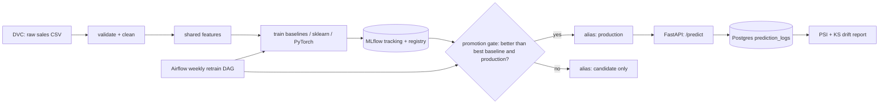

# Demand Forecasting MLOps Pipeline

Predict next-day unit sales per store and item, and demonstrate the complete ML lifecycle: versioned data, tracked experiments, an honest baseline/model comparison, a registry-backed API, scheduled retraining with a promotion gate, prediction logging and drift monitoring.

## 1. Architecture



The feature function in `src/features/build.py` is the only one used by both batch training and
serving, which prevents train/serve skew. All features at day `t` use observations through
`t-1` only; rolling statistics are computed on shifted sales.

## 2. Tech stack

| Area | Choice |
|---|---|
| Language / packaging | Python 3.11, `pyproject.toml` + pinned requirements |
| Data / features | pandas, numpy, pyarrow, `holidays` |
| Data versioning | DVC (local remote `../dvc-remote` by default) |
| Validation | explicit pandas checks with `DataValidationError` (pandera pinned for migration) |
| Models | baselines, Ridge, HistGradientBoostingRegressor, PyTorch MLP with embeddings |
| Tracking / registry | MLflow server + Postgres backend, registry aliases |
| Serving | FastAPI + Pydantic v2 + uvicorn |
| Orchestration | Airflow 2.10 LocalExecutor + Postgres |
| Logging / drift | Postgres + SQLAlchemy, PSI and Kolmogorov-Smirnov (scipy) |
| Tests / CI | pytest, pytest-cov, httpx/TestClient, ruff, GitHub Actions |
| Containers | Docker and Docker Compose |

## 3. Quick start

```bash
git clone <your-fork-url> demand-forecasting-mlops
cd demand-forecasting-mlops
cp .env.example .env
# Data is DVC-tracked. If the DVC remote is unavailable, generate the documented fallback:
python scripts/make_synthetic_data.py --out data/raw/train.csv --seed 42
dvc repro
docker compose up -d --build
```

- MLflow UI: <http://localhost:5000>
- Airflow UI: <http://localhost:8080> (`admin` / `admin` for this local demo)
- API docs: <http://localhost:8000/docs>

To register and promote a model locally after `make train`:

```bash
python -m src.models.promote --run-id <best_run_id_from_reports/train_summary.json>
```

Without Docker, everything except the Airflow/Postgres stack runs locally with
`MLFLOW_TRACKING_URI=sqlite:///mlflow.db` (the default).

## 4. API examples

Real examples captured from the locally running service with the production alias active
(full captures, including the 422 and `/admin/reload` responses, are in `reports/api_examples.md`):

```bash
curl -s http://localhost:8000/health | jq .
# {"status": "ok", "model_loaded": true}

curl -s -X POST http://localhost:8000/predict \
  -H 'Content-Type: application/json' \
  -d '{"store_id":1,"item_id":5,"forecast_date":"2018-01-01",
       "recent_sales":[12,11,10,13,14,15,16,12,11,10,13,14,15,16,
                       12,11,10,13,14,15,16,12,11,10,13,14,15,16],
       "price":9.99,"promo":0}' | jq .
# {
#   "prediction": 7.36,
#   "model_name": "demand-forecaster",
#   "model_version": "1",
#   "request_id": "4d0a686a-eefc-4045-a440-dc1737ab21d2",
#   "timestamp": "2026-11-24T16:05:05.737156+00:00"
# }

curl -s http://localhost:8000/model-info | jq .
# {
#   "model_name": "demand-forecaster",
#   "model_version": "1",
#   "alias": "production",
#   "training_date": "2026-11-24T15:40:10.482000+00:00",
#   "run_id": "3f5a277e7cec44a0b281baef212b2adf",
#   "validation_metrics": {"mae": 2.1200175826231664, "rmse": 3.0333942542170225,
#                          "mape": 12.555603867580531, "wape": 11.969655946516218},
#   "data_version": "536fde5487f76afc",
#   "loaded_at": "2026-11-24T16:05:04.078798+00:00"
# }
```

The `feature_list` field in the full `/model-info` response contains the 17 shared features
listed in `reports/evaluation.json`. A request with 27 instead of 28 `recent_sales` values
returns HTTP 422.

`recent_sales` must contain exactly 28 non-negative values ending the day before
`forecast_date`. Invalid input returns HTTP 422; a missing model returns 503 on `/health`,
`/model-info` and `/predict`.

## 5. Testing

```bash
make lint
make test          # includes --cov-fail-under=80
```

Coverage badge: ``
(placeholder badge; CI uploads the measured `coverage.xml` artifact).

## 6. Results

Dataset used for these numbers: **synthetic fallback**, 10 stores x 50 items, 2014-01-01 to
2018-12-31, seeded with 42. The real Kaggle dataset was not available in the build
environment (see `docs/DECISIONS.md`). All models were scored on the same final 90 days.

<!-- RESULTS_TABLE -->
| model | MAE | RMSE | MAPE | WAPE |
|---|---:|---:|---:|---:|
| last_week | 3.471 | 5.075 | 19.528 | 19.596 |
| moving_average | 3.351 | 4.745 | 19.629 | 18.922 |
| linear | 2.588 | 3.742 | 15.252 | 14.612 |
| hgb | 2.120 | 3.033 | 12.556 | 11.970 |
| nn | 2.257 | 3.247 | 13.194 | 12.741 |

Best learned model: **hgb**, with MAE 2.120 versus 3.351 for moving average (36.7% lower).
The neural net did not beat gradient boosting on MAE (2.257 vs 2.120). All models were scored
on the same 45,000 validation rows. See `reports/model_comparison.md` for the generated table.

Latency (from `reports/latency.json`, measured locally with 1,000 requests at concurrency 10):

| metric | value |
|---|---:|
| p50 | 1,074.7 ms |
| p95 | 1,498.4 ms |
| p99 | 1,725.4 ms |
| mean | 1,102.4 ms |
| throughput | 9.06 req/s |
| errors | 0 / 1,000 |

These are local single-worker measurements on the build workstation (each request also writes a
prediction-log row); they are not a production benchmark.

Screenshots:

- `docs/images/mlflow_compare.png` — <!-- TODO(human): screenshot -->
- `docs/images/airflow_dag.png` — <!-- TODO(human): screenshot -->

## 7. Design decisions and scaling

DVC keeps large data out of Git while making `dvc repro` reproducible. MLflow aliases avoid the
deprecated staging workflow, so a promotion is a single atomic alias swap that the API picks up
within `model_refresh_seconds` without a restart. Airflow tasks are thin wrappers around `src`
functions, so CLI runs and scheduled runs execute identical code. At larger scale, use a feature
store and Spark for feature generation, scheduled batch scoring for very high volume, managed
pipelines (Kubeflow Pipelines or SageMaker Pipelines) and managed endpoints; the promotion gate
would become a pipeline conditional with an audit trail.

## 8. Roadmap and known limitations

- Fixed one-day-ahead horizon; no multi-step recursive forecasting yet.
- Reported numbers come from synthetic data unless the Kaggle dataset is downloaded and the
  pipeline rerun with `DATASET_LABEL=kaggle`.
- No automated rollback beyond resetting the production alias; the previous version stays
  registered, so a human can restore it.
- MAPE is masked over positive actuals; WAPE is reported alongside it.
- Docker Compose acceptance steps require Docker, which was unavailable in the build env.
- API image size: `<!-- TODO(human): record docker images demand-api:latest output -->`.
- Human handoff items are listed in `docs/HANDOFF.md`.

## 9. Dataset source and license

Primary dataset: Kaggle *Store Item Demand Forecasting Challenge*
(<https://www.kaggle.com/competitions/demand-forecasting-kernels-only>), governed by the Kaggle
competition rules. The fallback generator is MIT-licensed with this repository (see `LICENSE`).
